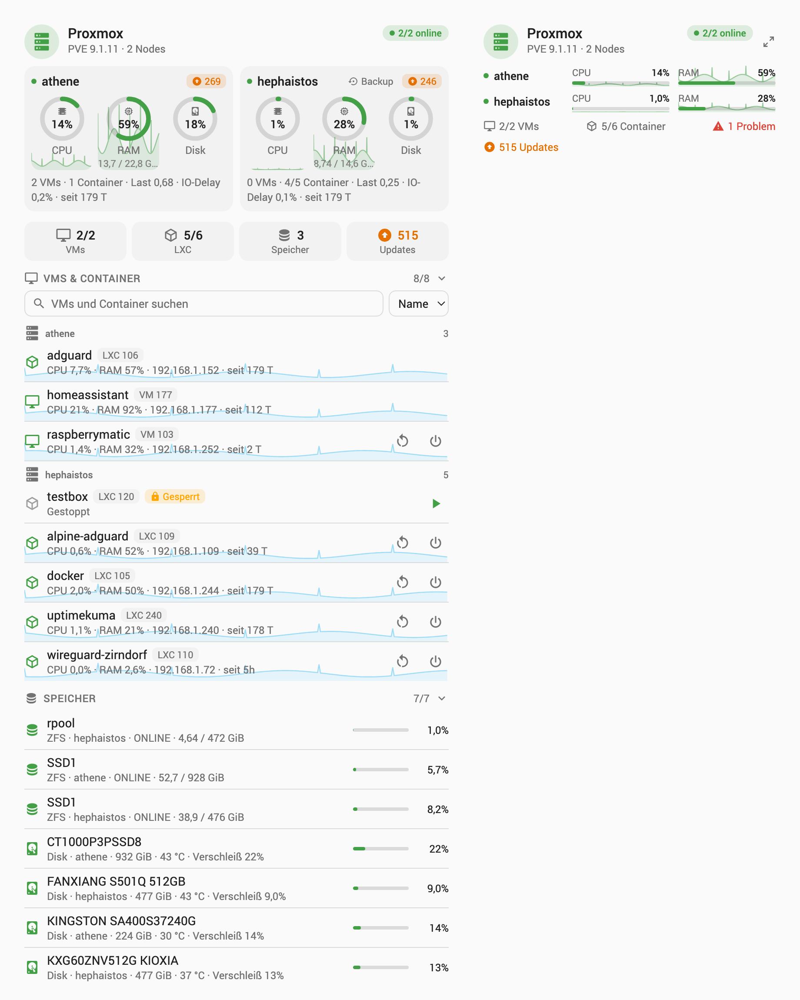
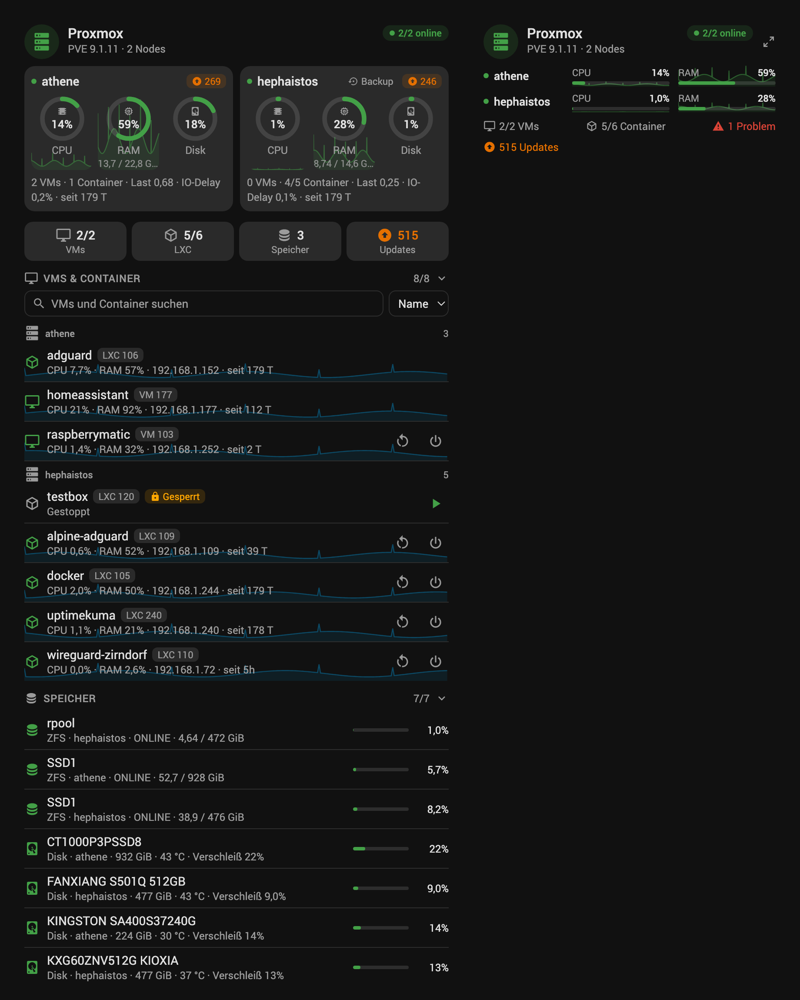

# ha-proxmox-card

[](https://github.com/hoentaex/ha-proxmox-card/actions/workflows/validate.yml)
[](https://github.com/hoentaex/ha-proxmox-card/actions/workflows/hacs.yml)
[](LICENSE)

Lovelace cards for Home Assistant to monitor and control a **Proxmox VE** cluster: nodes, virtual machines, LXC containers, storage, ZFS pools and disks at a glance, with start / shutdown / reboot buttons.

Built for the [Proxmox VE integration](https://github.com/dougiteixeira/proxmoxve) (custom integration, available in HACS). Entities are **discovered automatically** through the Home Assistant registries: no entity to pick, any language, any entity ids.

| Light | Dark |
|---|---|
|  |  |

## Features

- Two cards: a full **Proxmox Card** and a compact **Proxmox Mini Card**
- Header with the Proxmox VE version and how many nodes are online
- One panel per node: CPU, RAM and root disk rings (CPU and RAM with their last 24 hours behind them), cores, memory used / total, running VMs and containers, load, IO delay, uptime
- Node badges: pending package updates (opens the node's update entity), backup running, failed tasks
- Counters: VMs and LXC containers running, storages, package updates
- VMs and LXC containers list, grouped by node: state, CPU, RAM, IP address, uptime, locked and health flags, search and sort (name, ID, CPU, RAM), each guest's CPU over 24 h behind its row
- Start, shutdown and reboot buttons, with an in-card confirmation; an optional hard stop button
- Storage, ZFS pools and disks: usage, pool health, SMART status, temperature and wearout
- "Only items needing attention" mode, configurable orange / red thresholds for CPU, RAM and disk
- `nodes` option: a card for one node, or a subset of the cluster
- Mini card: CPU and RAM of every node with their 24 h curves, guests, problems and updates; its detail button switches to the full card
- Click any value to open its Home Assistant more-info dialog
- Visual editor for both cards, light and dark mode, English and German
- Single file, no external dependency

## Prerequisites

- Home Assistant 2024.8 or later
- The [Proxmox VE integration](https://github.com/dougiteixeira/proxmoxve) installed and configured, with the nodes, VMs and containers you want to see selected in it

The integration creates some entities **disabled**. Enable the ones you want in the card:

| Card | Entity of the integration |
|---|---|
| Start, shutdown, reboot, stop buttons | Guest buttons *Start*, *Shutdown*, *Reboot*, *Stop* (disabled by default; the Proxmox API token also needs the `VM.PowerMgmt` privilege) |
| Cores under the CPU ring | Node *CPUs* |
| Disk wearout, temperature, SMART | Disk entities (enable *Disks* in the integration options) |

## Installation

### HACS

1. HACS → ⋮ → **Custom repositories** → add `https://github.com/hoentaex/ha-proxmox-card`, type **Dashboard**
2. Open **Proxmox Card** and click **Download**
3. Reload the browser

### Manual

1. Download `proxmox-card.js` from the [latest release](https://github.com/hoentaex/ha-proxmox-card/releases/latest)
2. Copy it to `/config/www/`
3. **Settings → Dashboards → ⋮ → Resources** → add `/local/proxmox-card.js`, type **JavaScript Module**
4. Reload the browser

## Configuration

Edit a dashboard, **Add card**, search for **Proxmox Card** or **Proxmox Mini Card**: everything below is in the visual editor.

### Minimal

```yaml
type: custom:proxmox-card
```

```yaml
type: custom:proxmox-mini-card
```

### Full options

```yaml
type: custom:proxmox-card
title: Proxmox
nodes:            # only these nodes (default: all)
  - athene
show_nodes: true
show_history: true
show_counts: true
show_guests: true
show_storage: true
show_controls: true
show_stop: false
only_problems: false
group_by_node: true
expand_guests: true
expand_storage: false
cpu_warning: 70
cpu_critical: 90
ram_warning: 80
ram_critical: 95
disk_warning: 80
disk_critical: 90
language: de
```

```yaml
type: custom:proxmox-mini-card
title: Proxmox
show_history: true
show_footer: true
zoom: true
```

### Options

| Option | Card | Default | Description |
|---|---|---|---|
| `environment` | both | first one | Config entry id of the Proxmox VE integration, when there are several |
| `title` | both | `Proxmox` | Card title |
| `nodes` | both | all | Node names to show; their guests, storages, pools and disks follow (shared storages always shown) |
| `url` | both | Proxmox web UI | Address opened by the header icon |
| `show_nodes` | full | `true` | Node panels |
| `show_history` | both | `true` | 24 h CPU and RAM curves (recorder statistics) |
| `show_counts` | full | `true` | Counter tiles |
| `show_guests` | full | `true` | VMs and containers list |
| `show_storage` | full | `true` | Storage, ZFS pools and disks list |
| `show_controls` | full | `true` | Start / shutdown / reboot buttons |
| `show_stop` | full | `false` | Also the hard stop button |
| `only_problems` | full | `false` | Only list guests that are not running, locked or unhealthy, and storage near full or failing |
| `group_by_node` | full | `true` | Group the guests by node (with several nodes) |
| `expand_guests` | full | `true` | Guests list open when the card loads |
| `expand_storage` | full | `false` | Storage list open when the card loads |
| `show_footer` | mini | `true` | Guests, problems and updates under the nodes |
| `zoom` | mini | `true` | Detail button switching to the full card |
| `cpu_warning` / `cpu_critical` | both | `70` / `90` | CPU % turning orange / red |
| `ram_warning` / `ram_critical` | both | `80` / `95` | RAM % turning orange / red |
| `disk_warning` / `disk_critical` | full | `80` / `90` | Disk, storage, pool usage and SSD wearout % turning orange / red |
| `language` | both | auto | `en` or `de` |

## How the entities are found

The card reads `hass.entities` and `hass.devices`: entities of the `proxmoxve` platform, keyed by their translation key, on devices recognised by their identifier (`<entry>_NODE_<name>`, `_QEMU_<vmid>`, `_LXC_<vmid>`, `_STORAGE_…`, `_ZFS_…`, `_DISK_…`, `_cluster`), else by their model and name. A guest's node is read from its *Node* sensor, so it follows a migration.

## Development

```bash
npm run build      # dist/proxmox-card.js
npm test           # unit tests (node:test)
```

`preview/index.html` renders both cards against a mock Home Assistant (`preview/mock.js`, a two-node cluster): serve the repository root and open `/preview/index.html` (`?dark=1` for dark mode, `?full={…}` / `?mini={…}` for a card configuration).

## Credits

The design, the rendering helpers and much of the card structure come from [ha-docker-card](https://github.com/juju35/ha-docker-card) by juju35 (MIT).
